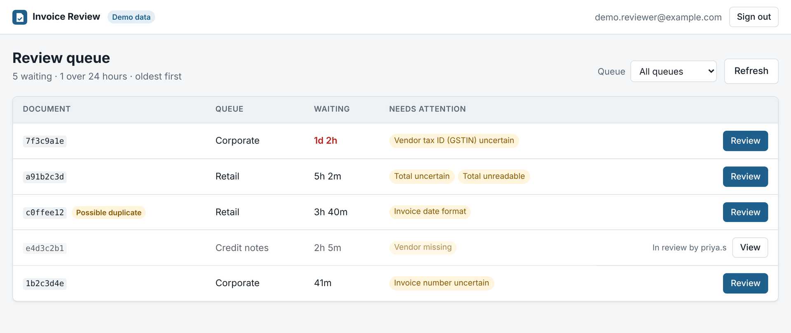
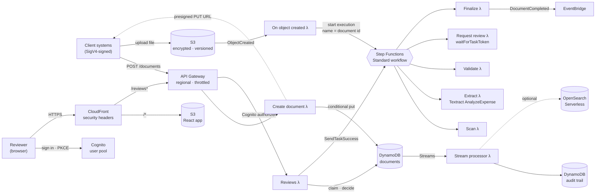
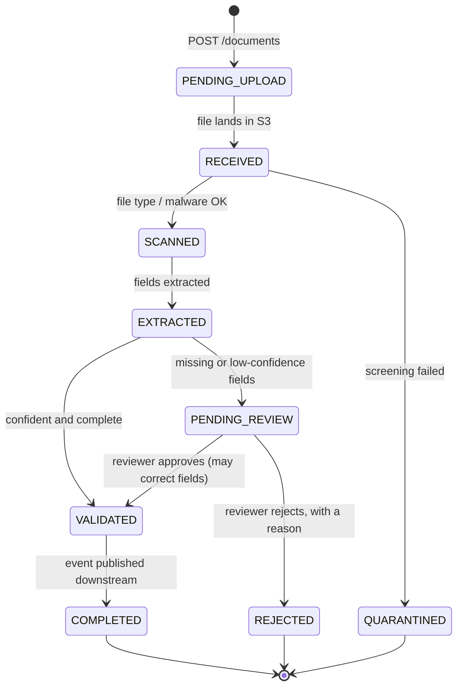
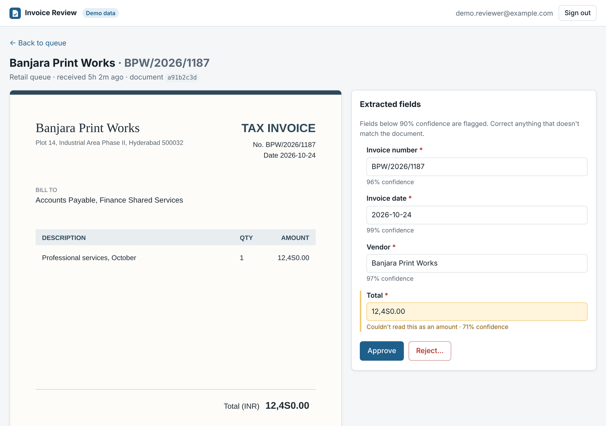

# Document Ingestion: serverless reference architecture

[](https://github.com/10vin10-cmd/document-ingestion-reference/actions/workflows/ci.yml)

An event-driven pipeline that takes invoices and other finance documents from upload to validated, structured data on AWS. It includes a **React reviewer app** for the documents the pipeline can't verify on its own. It shows the patterns that matter when a document pipeline runs at enterprise scale. Documents can't be lost or processed twice, and every state change is audited. Uncertain extractions go to a person, who sees the original next to the extracted fields and corrects them before anything reaches payables.

- **Backend:** AWS CDK (Python), Lambda, Step Functions, DynamoDB, S3, Textract
- **Reviewer app:** React 19 + TypeScript (Vite), TanStack Query, Cognito sign-in, served through CloudFront
- **Tests:** 80 backend and infrastructure tests (pytest + moto) and 24 UI tests (Vitest + Testing Library), all runnable without an AWS account

> This is an independent, from-scratch implementation of a design I have run in production. It contains no proprietary code or configuration.



---

## Architecture



### Document lifecycle



Any non-terminal state can also move to `FAILED` through the workflow's catch handler. That includes a review that isn't completed within 7 days.

---

## Reviewer app



Reviewers work a shared queue, oldest first. Items over 24 hours are highlighted. Opening a document **claims** it for 15 minutes, so two people don't work the same invoice. Anyone else who opens it gets a read-only view saying who has it. The original document (a short-lived presigned S3 URL) sits next to the extracted fields. Fields below the queue's confidence bar are flagged with the reason, such as "Couldn't read this as an amount" or "Use YYYY-MM-DD".

- **Approve** sends only the fields the reviewer changed, and the API records each change with its previous value. Approval is blocked while any required field is empty, both in the UI and on the server.
- **Reject** requires a reason, which goes into the audit trail.
- If two reviewers race anyway, exactly one decision wins. The other sees "Someone else completed this document", and the workflow resumes once.

**Try it without AWS:** `cd frontend && npm ci && npm run dev:demo` runs the app against an in-browser copy of the API with sample invoices. It follows the same claim and validation rules as the service, including a document held by another reviewer. The demo code is a separate chunk that production builds never include.

| | |
|---|---|
| `src/components/ReviewQueue.tsx` | Queue with filtering, wait times, issue chips and claim status. Refreshes every 30 s. |
| `src/components/ReviewScreen.tsx` | Claim-or-view on open, field editing with change tracking, approve and reject flows, conflict handling |
| `src/auth/CognitoGate.tsx` | OIDC authorization code + PKCE against Cognito. Group check, Cognito logout. |
| `src/api/client.ts` | Typed API client; errors carry the claim holder for 409s |
| `src/api/demo.ts` | In-browser API used by demo mode |

---

## Design decisions

| Decision | Why |
|---|---|
| **Step Functions *Standard*, not Express** | Human review can take days, while Express workflows are capped at five minutes. At ~80 requests/sec the volume is well within Standard's limits. The orchestration also carries the retry, catch and wait logic that would otherwise be hand-written. |
| **Single-item optimistic concurrency** | Each record has a `version`. Writes are conditional on the version they read *and* on the state the transition is allowed from ([`repository.py`](src/common/repository.py)). Contention is on one item, so this is cheaper and simpler than multi-item `TransactWriteItems`. The losing writer gets `ConcurrencyError`, and Step Functions retries it against fresh state. |
| **Review claims are leases, checked atomically** | A claim is a 15-minute lease on the record. A decision's write includes "unclaimed, mine, or expired" in the same condition as the version check, so there's no check-then-act gap. Leases expire on their own, so an abandoned tab never locks a document. |
| **Sparse index for the review queue** | `review_queue` exists only while a document waits for a person, and every exit path removes it (decision, timeout, failure). Listing the queue is a `Query` on a GSI holding only pending items, never a scan. The index projects only list columns; the workflow's task token is never projected. |
| **Human auth separate from machine auth** | Partner systems sign requests with IAM (SigV4). People sign in through Cognito, with no self sign-up, a `reviewers` group and optional TOTP MFA. Reviewer identity comes from the verified token, never the request body, so nobody can approve as someone else. |
| **App and API on one origin** | CloudFront serves the React app from S3 and routes `/reviews*` to API Gateway, uncached, with the `Authorization` header forwarded. There's no CORS to configure, and the API sits behind the same TLS, strict CSP, HSTS and `frame-ancestors 'none'` as the app. |
| **Runtime configuration** | The deployment writes `config.json` next to the app with the pool, client and domain. One build artifact runs in every environment. `index.html` and `config.json` are served `no-cache`, while hashed assets are immutable for a year. |
| **Idempotency at every entry point** | API retries reuse the document id derived from an `Idempotency-Key`. Redelivered S3 events start one workflow, because executions are named by document id. Retried workflow steps detect that their work is already done. Claiming again renews your own lease. |
| **Duplicates are flagged, never dropped** | Identical content (same SHA-256) is marked `possible_duplicate_of` and still processed. The reviewer sees a warning and decides. |
| **Audit trail from DynamoDB Streams** | Every change is captured from the stream, so no code path can skip auditing. Entries name the person for claims, releases and decisions, with corrections and rejection reasons. They're keyed by stream sequence number, so redelivery doesn't duplicate them. |
| **Files bypass the API** | Clients upload straight to S3 with a 15-minute presigned URL, and reviewers view through 5-minute presigned GETs. Lambda payload limits and data transfer stay out of the request path. |
| **Per-queue capture templates** | Each business queue defines its required fields and confidence bar ([`templates.py`](src/common/templates.py)), so onboarding a business line is configuration, not code. |

## Capacity sizing

| | |
|---|---|
| Volume | ~110K documents/day |
| Data operations | ~20 reads + ~20 writes per document → ~4.4M/day, sized at 5M with buffer |
| Sustained rate | 5M ÷ 86,400 s ≈ **58 ops/s** |
| Design target | **80 TPS** sustained. API Gateway is throttled at 100 rps with a 200 burst. |
| Compute | p95 < 300 ms, < 3 GB memory, nothing synchronous near 15 min → stateless Lambda, no always-on compute |
| Storage | DynamoDB on-demand (spiky month-end load), S3 with versioning and a 90-day non-current expiry |

## Repository layout

```
infra/ingestion_stack.py   CDK stack: storage, workflow, APIs, Cognito, CloudFront, alarms
src/common/                states, repository (concurrency + claims), identity, templates, validation
src/handlers/              Lambda entry points: intake, S3 trigger, workflow steps, reviews, stream
tests/                     backend, workflow, reviewer API, stream and infrastructure tests
frontend/                  React reviewer app (Vite + TypeScript) with its own tests
```

## Running it

**Tests** run locally with no AWS account:

```bash
python -m venv .venv && source .venv/bin/activate
pip install -r requirements-dev.txt
pytest                                    # backend + infrastructure

cd frontend && npm ci && npm test         # reviewer app
```

**Deploy** a demo stack. The stub extractor avoids Textract charges, and ephemeral mode lets `cdk destroy` remove the data:

```bash
(cd frontend && npm ci && npm run build)  # the stack publishes frontend/dist
npm install -g aws-cdk
cdk deploy -c extractor=stub -c ephemeral=true
```

**Create a reviewer.** There's no self sign-up; Cognito emails a temporary password:

```bash
POOL=<UserPoolId output>
aws cognito-idp admin-create-user --user-pool-id $POOL --username you@example.com \
  --user-attributes Name=email,Value=you@example.com Name=email_verified,Value=true
aws cognito-idp admin-add-user-to-group --user-pool-id $POOL \
  --username you@example.com --group-name reviewers
```

**Send a document** with [awscurl](https://github.com/okigan/awscurl) for SigV4 signing, then review it in the app:

```bash
API=<ApiUrl output>
awscurl --service execute-api -X POST "$API/documents" \
  -H "Idempotency-Key: demo-1" \
  -d '{"business_queue": "corporate", "file_name": "invoice.pdf"}'
# → { "document_id": "...", "status": "PENDING_UPLOAD", "upload_url": "https://..." }

curl -X PUT --upload-file invoice.pdf "<upload_url>"
# corporate queue + stub extractor → the tax ID is below the 92% bar, so the
# document appears in the review queue at <ReviewAppUrl output>
```

**Run the app locally against a deployed stack:** copy `frontend/public/config.example.json` to `config.json` and fill it from the stack outputs. Then run `API_PROXY_TARGET=<ApiUrl> npm run dev`. `http://localhost:5173/` is already an allowed sign-in callback.

Context flags: `extractor` (`textract` | `stub`), `enableSearch` (provision OpenSearch Serverless), `ephemeral` (destroy data on teardown), `authDomainPrefix` (Cognito sign-in domain).

## What a production deployment would add

- A real malware engine in the scan step. The step currently screens file size and type by magic bytes.
- Asynchronous Textract (`StartExpenseAnalysis`) for multi-page PDFs.
- Per-queue reviewer permissions (a group per business line), a second approver above an amount threshold, and SSO federation (SAML/OIDC) instead of Cognito-managed passwords.
- A custom domain with ACM certificate, AWS WAF on CloudFront and the API, customer-managed KMS keys, and an alarm-to-pager route (SNS).
- Templates served from a configuration service, and mailbox and scanner ingestion paths feeding the same `incoming/` prefix.

## License

MIT
