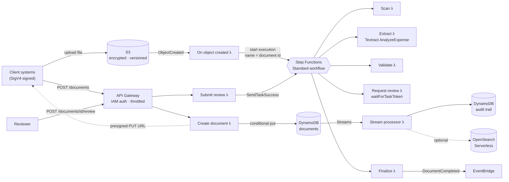
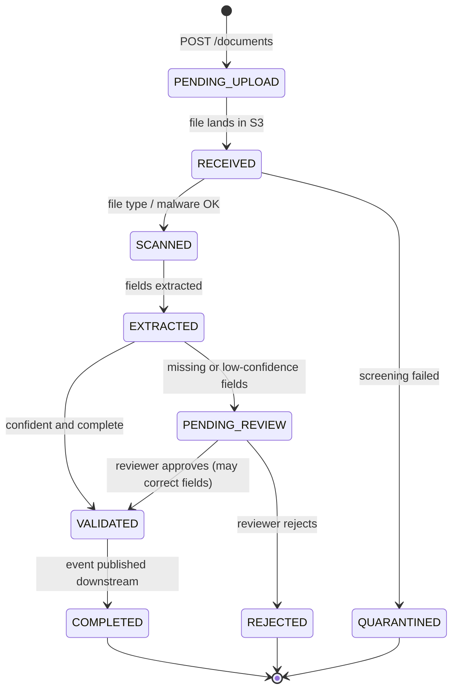

# Document Ingestion — serverless reference architecture

[](https://github.com/10vin10-cmd/document-ingestion-reference/actions/workflows/ci.yml)

An event-driven pipeline that takes invoices and other finance documents from upload to validated, structured data on AWS. It shows the patterns that matter when a document pipeline runs at enterprise scale. Documents can't be lost or processed twice, and every state change is audited. Uncertain extractions go to a human instead of being silently accepted.

Everything is defined in **AWS CDK (Python)**. Tests run locally with **pytest + moto**, with no AWS account needed.

> This is an independent, from-scratch implementation of a design I have run in production. It contains no proprietary code or configuration.

---

## Architecture



### Document lifecycle



Any non-terminal state can also move to `FAILED` through the workflow's catch handler.

---

## Design decisions

| Decision | Why |
|---|---|
| **Step Functions *Standard*, not Express** | Human review can take days, while Express workflows are capped at five minutes. At ~80 requests/sec the volume is well within Standard's limits. The orchestration also carries the retry, catch and wait logic that would otherwise be hand-written. |
| **Single-item optimistic concurrency** | Each record has a `version`. Writes are conditional on the version they read *and* on the state the transition is allowed from ([`repository.py`](src/common/repository.py)). Contention is on one item (a workflow step racing a reviewer), so this is cheaper and simpler than multi-item `TransactWriteItems`. The losing writer gets `ConcurrencyError`, and Step Functions retries it against fresh state. |
| **Idempotency at every entry point** | API retries reuse the document id derived from an `Idempotency-Key`. Redelivered S3 events start one workflow, because executions are named by document id and duplicate names are rejected. Retried workflow steps detect that their work is already done and return the stored result. |
| **Duplicates are flagged, never dropped** | Identical content (same SHA-256) is marked `possible_duplicate_of` and still processed. An automated discard rule can silently lose a legitimate invoice, and that costs far more than a reviewer's minute. |
| **Human-in-the-loop via task token** | Low-confidence extractions pause the workflow with `waitForTaskToken`. The token is stored on the record, never returned by the API, and consumed exactly once. A second reviewer submission gets `409`. |
| **Audit trail from DynamoDB Streams** | Every change is captured from the stream, not written by each handler, so no code path can skip auditing. Entries are keyed by stream sequence number, so redelivery doesn't duplicate them. |
| **Files bypass the API** | Clients upload straight to S3 with a 15-minute presigned URL. That keeps Lambda payload limits and data-transfer cost out of the request path. |
| **Machine-to-machine auth with IAM** | Partner systems sign requests with SigV4. There are no shared API keys to rotate or leak. |
| **Per-queue capture templates** | Each business queue (retail, corporate, credit notes) defines its required fields and confidence threshold ([`templates.py`](src/common/templates.py)), so onboarding a new business line is configuration, not code. |

## Capacity sizing

| | |
|---|---|
| Volume | ~110K documents/day |
| Data operations | ~20 reads + ~20 writes per document → ~4.4M/day, sized at 5M with buffer |
| Sustained rate | 5M ÷ 86,400 s ≈ **58 ops/s** |
| Design target | **80 TPS** sustained. API Gateway is throttled at 100 rps with a 200 burst. |
| Compute | p95 < 300 ms, < 3 GB memory, nothing synchronous near 15 min → stateless Lambda, no always-on compute |
| Storage | DynamoDB on-demand (spiky month-end load), S3 with versioning and a 90-day non-current expiry |

## Repository layout

```
infra/ingestion_stack.py   CDK stack: storage, functions, workflow, API, alarms
src/common/                states, repository (concurrency), templates, validation
src/handlers/              Lambda entry points (API, S3 trigger, workflow steps, stream)
tests/                     47 tests: repository, validation, API, workflow, stream, stack
```

## Running it

**Tests** run locally with no AWS account:

```bash
python -m venv .venv && source .venv/bin/activate
pip install -r requirements-dev.txt
pytest
```

**Deploy** a demo stack. The stub extractor avoids Textract charges, and ephemeral mode lets `cdk destroy` remove the data:

```bash
npm install -g aws-cdk
cdk deploy -c extractor=stub -c ephemeral=true
```

**Try it** with [awscurl](https://github.com/okigan/awscurl) for SigV4 signing:

```bash
API=<ApiUrl output>
awscurl --service execute-api -X POST "$API/documents" \
  -H "Idempotency-Key: demo-1" \
  -d '{"business_queue": "corporate", "file_name": "invoice.pdf"}'
# → { "document_id": "...", "status": "PENDING_UPLOAD", "upload_url": "https://..." }

curl -X PUT --upload-file invoice.pdf "<upload_url>"

awscurl --service execute-api "$API/documents/<document_id>"
# corporate queue + stub extractor → PENDING_REVIEW (tax id below the 92% threshold)

awscurl --service execute-api -X POST "$API/documents/<document_id>/review" \
  -d '{"approved": true, "reviewer": "me", "corrected_fields": {"TAX_PAYER_ID": "36AAAAA0000A1Z5"}}'
# → VALIDATED; the workflow resumes and completes
```

Context flags: `extractor` (`textract` | `stub`), `enableSearch` (provision OpenSearch Serverless), `ephemeral` (destroy data on teardown).

## What a production deployment would add

- A real malware engine in the scan step. The step currently screens file size and type by magic bytes.
- Asynchronous Textract (`StartExpenseAnalysis`) for multi-page PDFs.
- Customer-managed KMS keys, AWS WAF on the API, and an alarm-to-pager route (SNS).
- A reviewer UI on top of the review API, and templates served from a configuration service.
- Mailbox and scanner ingestion paths feeding the same `incoming/` prefix.

## License

MIT
